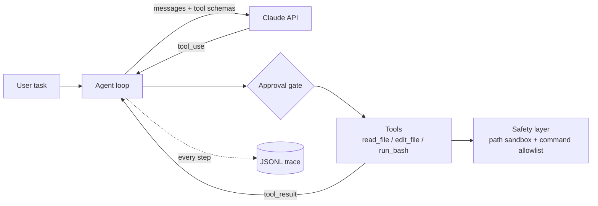

# Coding Agent CLI

A command-line coding agent built from scratch in Python on the Anthropic API. It reads code, edits files, and runs tests in a sandboxed project folder. It ships with an evaluation harness that scores it on hidden unit tests, plus run tracing so every result can be traced back to the exact prompt, tools, and code that produced it.

No agent framework is used. The tool-use loop, tool layer, safety checks, evals, and observability are all written by hand, so each design decision is visible and testable.

## Results

Core suite (20 tasks), 3 repeats per task:

| Model | Runs | Pass rate | Tool calls / task | Tokens / task | Cost / task |
|---|---|---|---|---|---|
| Claude Haiku 5.5 | 60 | **100%** | 4.2 | ~4,600 | **$0.0008** |

| Category | Tasks | Pass rate | Tool calls / task |
|---|---|---|---|
| Bug fix | 10 | 100% | 3.7 |
| Feature | 6 | 100% | 4.4 |
| Multi-file | 4 | 100% | 5.3 |

Hard suite (12 tasks), 3 repeats per task, used to choose the default model:

| Model | Pass rate | Tool calls / task | Tokens / task | Cost / task |
|---|---|---|---|---|
| Claude Haiku 5.5 | 92% (33/36) | 6.9 | ~8,900 | **$0.0014** |
| Claude Sonnet 5.5 | 100% (36/36) | 6.3 | ~7,100 | $0.0219 |

Haiku matched Sonnet on 11 of 12 tasks at about 1/16 of the cost. All of its misses came from one task whose hidden test required behavior the task never specified; auditing the traces caught this, and the task spec was fixed rather than tuning the agent to it. Both runs were measured before the completion gate below was added.

## How it works



1. The agent sends the conversation and three JSON-Schema tool definitions to the model.
2. When the model returns `tool_use`, the agent runs the tool locally and sends back a `tool_result`, marked `is_error` on failure so the model can recover.
3. The loop ends when the model stops calling tools, or at a hard step limit.

## Features

### Tools
| Tool | Behavior |
|---|---|
| `read_file` | Reads a file inside the project. |
| `edit_file` | Exact string replacement. `old_str` must match **exactly once**, so an ambiguous edit fails loudly instead of changing the wrong spot. Empty `old_str` creates a new file but never overwrites one. |
| `run_bash` | Runs an allowlisted command (`ls`, `cat`, `grep`, `pytest`, `python`, …) as an argument list with no shell, a 30s timeout, and output truncated to the last 4,000 characters. |

### Hunk-level diff review
In interactive mode, an edit is a proposal, not a write. The agent computes the new file, the CLI shows a colored unified diff split into hunks, and for each hunk you choose:

| Key | Action |
|---|---|
| `y` / `n` | accept / reject this hunk |
| `e` | open the proposed lines in `$EDITOR` and use your version |
| `a` / `d` | accept / reject this and all remaining hunks |

Only the chosen result is written. The tool result tells the model exactly what happened ("2 accepted, 1 rejected; rejected hunks were NOT applied"), so it doesn't assume its full edit landed. Rejecting every hunk writes nothing and returns a `denied` error asking the model to check with you. The diff review replaces the generic yes/no approval for edits; shell commands still use the approval prompt.

### Checkpoints and `/undo`
Before every turn, the CLI snapshots the working tree as a commit on a private ref, `refs/agent/checkpoints`. The snapshot is built with a temporary index, so **your branch, HEAD, and staging area are never touched**, and `.gitignore`d files (like `.env` or `.venv`) are never captured or overwritten.

| Command | What it does |
|---|---|
| `/undo` | Revert every file change from the last turn that changed something, including deleting files it created |
| `/redo` | Re-apply the last undone turn |
| `/diff` | Show what the last turn changed |
| `/cost` | Tokens and dollar cost for the session |

Turns that change nothing are dropped from the undo stack, so `/undo` always reverts real work. After an undo, the model is told on its next turn that its changes were reverted, so it doesn't build on files that no longer exist. Requires the project to be a git repository.

### Completion gate: verify, feed back, roll back
When the agent says it's done, the gate checks its work before the turn can end:

1. **Lint** the files it changed with Ruff, limited to rules that are almost always real bugs (syntax errors, undefined names).
2. **Run the project's tests** and compare against a baseline taken before the first edit, so only failures the agent *introduced* count. Pre-existing failures are not blamed on it.
3. If there are new failures, they are sent back to the model and the turn continues.
4. After 3 failed attempts in a row, **every edit from the turn is rolled back** (edited files restored, created files removed), and the model explains what went wrong without calling more tools (`tool_choice: none`).

Checks run at completion rather than after every edit, so a multi-file refactor isn't interrupted while it's half done. A test caught an early bug where the agent could skip the gate by simply saying "done" again without editing; the gate now re-checks whenever a failure is outstanding. Disable with `--no-verify`.

### Security model
The threat model assumes the model can be manipulated by prompt injection inside files it reads, so defenses are enforced in code rather than in the prompt.

- **Path sandbox:** every path is resolved (including symlinks) and must stay inside the workspace. This blocks `../` traversal, absolute paths, and symlink escapes.
- **Command allowlist:** commands are parsed with `shlex` and executed without a shell, so `;`, `&&`, and `|` cannot chain extra commands.
- **Human approval:** every write and command needs confirmation, defaulting to deny.
- **Limits:** step cap and command timeouts prevent runaway loops.
- **Tests:** 18 attack-case tests cover traversal, symlink escape, destructive commands, network access, and privilege escalation.

**Known limitation:** `python` and `pytest` are on the allowlist and can execute arbitrary code, so the allowlist stops accidental damage but is not a hard boundary. The planned fix is to run tools inside a Docker container with no network access.

### Evaluation harness
- **32 tasks in two suites.** *Core* (20): bug fixes, features, multi-file changes. *Hard* (12): cross-module renames (including aliased imports), specs that must be inferred from existing tests, bug reports that point at the wrong file, unstated edge cases (atomicity, input mutation, empty input), constraint following ("don't use the csv module", "don't edit the tests"), and a feature spanning model, store, and view layers.
- Each task has starting code, a natural-language prompt, **hidden unit tests**, and a reference solution.
- Each run copies the task into a temp directory, runs the agent with auto-approval, then runs the hidden tests. The tests live **outside the agent's sandbox**, so it cannot read or overfit to them.
- **Task validation:** `--validate` checks that every hidden test fails on the original code and passes with the reference fix. This caught a stale-bytecode bug (same-size edits within the same second reused cached `.pyc` files) that would have scored correct fixes as failures.
- **Tamper detection:** tasks can mark files as protected, such as visible tests the agent is told not to edit. If the agent changes them, the run is scored `tampered` instead of passing, so it can't succeed by weakening the tests.
- **Repeats** (`--repeat N`) measure variance, since model outputs are non-deterministic.
- An **oracle test** replays every reference solution through the full harness and must score 100%, which verifies the harness itself.

### Observability
- **Run manifest:** each run records content hashes of the system prompt, tool schemas, and task set, plus the git commit, model, config, and SDK version. Any result traces back to the version that produced it.
- **JSONL traces:** one file per task run, with an event for every model call (latency, tokens, stop reason) and tool call (arguments, latency, typed error, output).
- **Error taxonomy:** tools raise typed errors (`edit_mismatch`, `policy_block`, `file_not_found`, `bad_args`, `timeout`, …). Task failures are classified as `api_error`, `harness_crash`, `rolled_back`, `step_limit`, `tampered`, `no_change`, or `wrong_fix`, separating infrastructure problems from agent mistakes.
- **Latency and cost:** model time vs. tool time, p50/p95 per task, and token cost per task.
- **Regression report:** compares two runs task by task, flags changed prompt/tool/task versions, and exits non-zero below a pass-rate threshold so it can gate CI.

## Quick start

```bash
python3 -m venv .venv
source .venv/bin/activate
pip install -r requirements.txt
export ANTHROPIC_API_KEY="sk-ant-..."
```

Interactive agent:
```bash
python cli.py                # diff review, /undo, lint/test gate
python cli.py --no-verify    # skip the lint/test gate
```

Evaluation:
```bash
python eval.py --validate                              # check tasks, no API calls
python eval.py --repeat 3 --model claude-haiku-5-5     # run all tasks
python eval.py --suite hard --model claude-sonnet-5-5   # only the hard suite
python eval.py --suite hard --no-verify                 # ablation: gate off
python report.py latest                                # summary of the newest run
python report.py latest --trace 17_slugify             # step-by-step trace of one task
python report.py OLD_RUN NEW_RUN --threshold 0.9       # regression report
```

Tests (no API key needed; the model is replaced by a scripted fake):
```bash
pytest -q
```

## Project structure

```
cli.py            Interactive session: slash commands, checkpoints per turn, cost tracking
agent.py          Agent loop, tools, approval gate, typed tool errors
checkpoints.py    Git snapshots on a private ref; undo/redo per turn
pricing.py        Model prices and cost calculation
verify.py         Completion gate: lint, baseline-aware tests, rollback
review.py         Hunk-level diff review: split, render, apply accepted hunks
safety.py         Path sandbox and command allowlist
eval.py           Eval harness: task runner, hidden tests, scoring, failure taxonomy
tracing.py        JSONL tracer and versioned run manifest
report.py         Run summaries, traces, regression comparison
evals/tasks/      32 tasks (core + hard): task.json, repo/, hidden_test.py, solution/
evals/runs/       Run outputs (git-ignored): manifest.json, results.jsonl, traces/
test_safety.py    18 security tests
test_eval.py      Harness, tracing, taxonomy, and regression tests
test_verify.py    Completion gate: feedback, rollback, baseline handling
test_review.py    Hunk splitting, partial apply, user edits, agent integration
test_checkpoints.py  Undo/redo, untouched user git state, ignored files, CLI session
```

## Roadmap

- [x] Agent loop with tool use
- [x] Safety layer and approval gate
- [x] Evaluation harness with validated hidden tests
- [x] Observability: traces, run manifests, error taxonomy, regression reports
- [x] Hard task suite with tamper detection
- [x] Completion gate: lint + tests on finish, feedback, rollback
- [x] Hunk-level diff review (accept / reject / edit per hunk)
- [x] Git checkpoints, `/undo`, `/redo`, `/diff`, `/cost`
- [ ] pipx packaging, CI, demo GIF
- [ ] Reliability: retries with exponential backoff, circuit breaker, record/replay of model calls
- [ ] CI regression gate in GitHub Actions
- [ ] Docker sandbox for tool execution
- [ ] Context compaction for long sessions
- [ ] MCP client support
