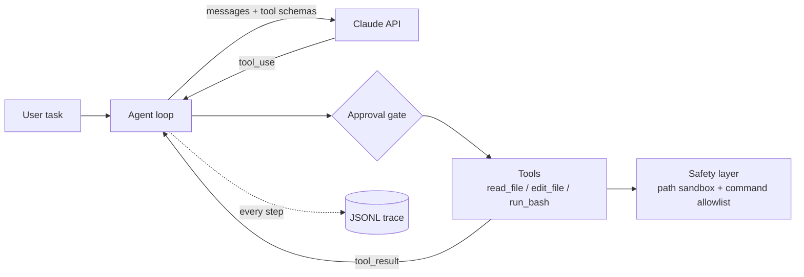
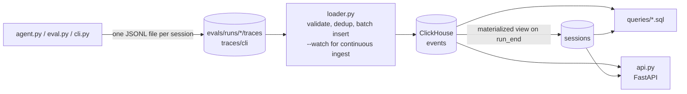

# Coding Agent CLI

A command-line coding agent built from scratch in Python on the Anthropic API. It reads code, edits files, and runs tests in a sandboxed project folder. It ships with an evaluation harness that scores it on hidden unit tests, plus run tracing so every result can be traced back to the exact prompt, tools, and code that produced it.

No agent framework is used. The tool-use loop, tool layer, safety checks, evals, and observability are all written by hand, so each design decision is visible and testable.

## Results

Core suite (20 tasks), 3 repeats per task:

| Model | Runs | Pass rate | Tool calls / task | Tokens / task | Cost / task |
|---|---|---|---|---|---|
| Claude Haiku 5.5 | 60 | **100%** | 4.2 | ~4,600 | **$0.0008** |

| Category | Tasks | Pass rate | Tool calls / task |
|---|---|---|---|
| Bug fix | 10 | 100% | 3.7 |
| Feature | 6 | 100% | 4.4 |
| Multi-file | 4 | 100% | 5.3 |

Hard suite (12 tasks), 3 repeats per task, used to choose the default model:

| Model | Pass rate | Tool calls / task | Tokens / task | Cost / task |
|---|---|---|---|---|
| Claude Haiku 5.5 | 92% (33/36) | 6.9 | ~8,900 | **$0.0014** |
| Claude Sonnet 5.5 | 100% (36/36) | 6.3 | ~7,100 | $0.0219 |

Haiku matched Sonnet on 11 of 12 tasks at about 1/16 of the cost. All of its misses came from one task whose hidden test required behavior the task never specified; auditing the traces caught this, and the task spec was fixed rather than tuning the agent to it. Both runs were measured before the completion gate below was added.

## How it works



1. The agent sends the conversation and three JSON-Schema tool definitions to the model.
2. When the model returns `tool_use`, the agent runs the tool locally and sends back a `tool_result`, marked `is_error` on failure so the model can recover.
3. The loop ends when the model stops calling tools, or at a hard step limit.

## Features

### Tools
| Tool | Behavior |
|---|---|
| `read_file` | Reads a file inside the project. |
| `edit_file` | Exact string replacement. `old_str` must match **exactly once**, so an ambiguous edit fails loudly instead of changing the wrong spot. Empty `old_str` creates a new file but never overwrites one. |
| `run_bash` | Runs an allowlisted command (`ls`, `cat`, `grep`, `pytest`, `python`, …) as an argument list with no shell, a 30s timeout, and output truncated to the last 4,000 characters. |

### Hunk-level diff review
In interactive mode, an edit is a proposal, not a write. The agent computes the new file, the CLI shows a colored unified diff split into hunks, and for each hunk you choose:

| Key | Action |
|---|---|
| `y` / `n` | accept / reject this hunk |
| `e` | open the proposed lines in `$EDITOR` and use your version |
| `a` / `d` | accept / reject this and all remaining hunks |

Only the chosen result is written. The tool result tells the model exactly what happened ("2 accepted, 1 rejected; rejected hunks were NOT applied"), so it doesn't assume its full edit landed. Rejecting every hunk writes nothing and returns a `denied` error asking the model to check with you. The diff review replaces the generic yes/no approval for edits; shell commands still use the approval prompt.

### Checkpoints and `/undo`
Before every turn, the CLI snapshots the working tree as a commit on a private ref, `refs/agent/checkpoints`. The snapshot is built with a temporary index, so **your branch, HEAD, and staging area are never touched**, and `.gitignore`d files (like `.env` or `.venv`) are never captured or overwritten.

| Command | What it does |
|---|---|
| `/undo` | Revert every file change from the last turn that changed something, including deleting files it created |
| `/redo` | Re-apply the last undone turn |
| `/diff` | Show what the last turn changed |
| `/cost` | Tokens and dollar cost for the session |

Turns that change nothing are dropped from the undo stack, so `/undo` always reverts real work. After an undo, the model is told on its next turn that its changes were reverted, so it doesn't build on files that no longer exist. Requires the project to be a git repository.

### Completion gate: verify, feed back, roll back
When the agent says it's done, the gate checks its work before the turn can end:

1. **Lint** the files it changed with Ruff, limited to rules that are almost always real bugs (syntax errors, undefined names).
2. **Run the project's tests** and compare against a baseline taken before the first edit, so only failures the agent *introduced* count. Pre-existing failures are not blamed on it.
3. If there are new failures, they are sent back to the model and the turn continues.
4. After 3 failed attempts in a row, **every edit from the turn is rolled back** (edited files restored, created files removed), and the model explains what went wrong without calling more tools (`tool_choice: none`).

Checks run at completion rather than after every edit, so a multi-file refactor isn't interrupted while it's half done. A test caught an early bug where the agent could skip the gate by simply saying "done" again without editing; the gate now re-checks whenever a failure is outstanding. Disable with `--no-verify`.

### Security model
The threat model assumes the model can be manipulated by prompt injection inside files it reads, so defenses are enforced in code rather than in the prompt.

- **Path sandbox:** every path is resolved (including symlinks) and must stay inside the workspace. This blocks `../` traversal, absolute paths, and symlink escapes.
- **Command allowlist:** commands are parsed with `shlex` and executed without a shell, so `;`, `&&`, and `|` cannot chain extra commands.
- **Human approval:** every write and command needs confirmation, defaulting to deny.
- **Limits:** step cap and command timeouts prevent runaway loops.
- **Tests:** 19 attack-case tests cover traversal, symlink escape, destructive commands, network access, and privilege escalation.

**Known limitation:** `python` and `pytest` are on the allowlist and can execute arbitrary code, so the allowlist stops accidental damage but is not a hard boundary. The planned fix is to run tools inside a Docker container with no network access.

### Evaluation harness
- **32 tasks in two suites.** *Core* (20): bug fixes, features, multi-file changes. *Hard* (12): cross-module renames (including aliased imports), specs that must be inferred from existing tests, bug reports that point at the wrong file, unstated edge cases (atomicity, input mutation, empty input), constraint following ("don't use the csv module", "don't edit the tests"), and a feature spanning model, store, and view layers.
- Each task has starting code, a natural-language prompt, **hidden unit tests**, and a reference solution.
- Each run copies the task into a temp directory, runs the agent with auto-approval, then runs the hidden tests. The tests live **outside the agent's sandbox**, so it cannot read or overfit to them.
- **Task validation:** `--validate` checks that every hidden test fails on the original code and passes with the reference fix. This caught a stale-bytecode bug (same-size edits within the same second reused cached `.pyc` files) that would have scored correct fixes as failures.
- **Tamper detection:** tasks can mark files as protected, such as visible tests the agent is told not to edit. If the agent changes them, the run is scored `tampered` instead of passing, so it can't succeed by weakening the tests.
- **Repeats** (`--repeat N`) measure variance, since model outputs are non-deterministic.
- An **oracle test** replays every reference solution through the full harness and must score 100%, which verifies the harness itself.

### Observability
- **Run manifest:** each run records content hashes of the system prompt, tool schemas, and task set, plus the git commit, model, config, and SDK version. Any result traces back to the version that produced it.
- **JSONL traces:** one file per task run, with an event for every model call (latency, tokens, stop reason), tool call and tool result (argument and output hashes and sizes, latency, typed error; content only with `--trace-content`). See [Trace Analytics](#trace-analytics).
- **Error taxonomy:** tools raise typed errors (`edit_mismatch`, `policy_block`, `file_not_found`, `bad_args`, `timeout`, …). Task failures are classified as `api_error`, `harness_crash`, `rolled_back`, `step_limit`, `tampered`, `no_change`, or `wrong_fix`, separating infrastructure problems from agent mistakes.
- **Latency and cost:** model time vs. tool time, p50/p95 per task, and token cost per task.
- **Regression report:** compares two runs task by task, flags changed prompt/tool/task versions, and exits non-zero below a pass-rate threshold so it can gate CI.

## Trace Analytics

Every agent session is recorded as a structured trace, loaded into ClickHouse, and exposed through SQL queries and a small HTTP API.



**Terms.** A *session* is one agent conversation: one task attempt in an eval, or one interactive `cli.py` session. A *run* is one `eval.py` invocation (the `run_id` in the existing run manifest), so a run contains many sessions.

### Trace schema

Every event carries the same envelope: `run_id`, `session_id`, `event_id`, `parent_event_id`, `ts` (UTC, ms), `seq` (position in the file, used to order events that share a millisecond), `type`, `model`, `input_tokens`, `output_tokens`, `latency_ms`, `tool_name`, `tool_args_hash`, `args_size_bytes`, `status`, `error`, `cost_usd` (from `pricing.py`).

| Event | Parent | Notes |
|---|---|---|
| `run_start` | — | task id, suite, category |
| `model_call` | `run_start` | tokens, latency, cost, stop reason |
| `tool_call` | the `model_call` that requested it | args hash and size, `target_hash` (hash of the file path) |
| `approval_decision` | `tool_call` | approved / denied / partial, and which approver (prompt, auto, diff review) |
| `tool_result` | `tool_call` | latency, status, typed error kind, output hash and size |
| `verify` / `rollback` | finishing `model_call` / `verify` | completion gate result |
| `api_error` | `run_start` | API exception type |
| `run_end` | `run_start` | session totals, `task_id`, `suite`, `passed`, `failure_type`, `failure_root_cause` |

**Redaction is the default.** Tool arguments and outputs, model text, and prompts are stored only as a SHA-256 prefix and a byte size, never as content. `--trace-content` (on `eval.py` and `cli.py`) keeps today's truncated content for local debugging; obvious secrets (`sk-ant-…`, AWS keys, GitHub tokens, `password=…`) are masked even then. `report.py --trace` works on both: it shows content when present and `[redacted: N bytes, sha …]` otherwise. Traces from before this change (`task_start` / `task_end`, no envelope) still print in `report.py`; the loader rejects them with a reason because they have no `run_id`.

### Failure root cause

`failure_type` (existing) says *what* happened. `failure_root_cause` (new, on `run_end`) is a guess at *why*, derived from the trace by these rules, applied in order to failed sessions. The first rule that matches wins. The code is in `tracing.failure_root_cause`.

| Root cause | Rule |
|---|---|
| `looping_edits` | the same file was edited more than 3 times, or the same tool was called with identical arguments (`tool_name` + `tool_args_hash`) more than 3 times |
| `premature_finish` | the model ended the session itself (not the step limit) with zero successful edits, or with the completion gate failing on its last check (including a rollback) |
| `bad_file_context` | some `tool_result` failed with `file_not_found` or `edit_mismatch` |
| `other` | none of the above, e.g. a wrong fix with clean tool use, step limit without repetition, tampering, API errors |

Passing sessions get `none`. Because the rules run in order, an agent that hits `file_not_found` and then gives up without editing anything is `premature_finish`, not `bad_file_context`.

### Storage

`schema.sql` creates three tables in the `agent_analytics` database:

- **`events`**: one row per event. `ReplacingMergeTree(ingested_at)`, `ORDER BY (session_id, ts, event_id)`, partitioned by month. Fields outside the envelope are kept as JSON in `attrs`. `task_id` and `suite` are copied from `run_start` onto every event of the session so they can be filtered without a join.
- **`sessions`**: one row per finished session, filled by a materialized view from `run_end` (which carries the totals): tokens, cost, duration, tool calls, edits, `passed`, `status`, `failure_type`, `failure_root_cause`. Sessions that never wrote `run_end` (crashed, or still running) are only in `events`.
- **`rejected_rows`**: rows the loader refused, with file, line and reason.

**Idempotency.** Before inserting, the loader looks up which `event_id`s of the batch's sessions are already stored and inserts only the new ones. Re-loading a file inserts nothing, and a file that grew since the last load (a run still in progress) inserts only its new lines. I chose this over delete-then-insert per run because the `sessions` materialized view fires on insert: deleting and re-inserting a run would need the view's rows deleted too, and `ALTER … DELETE` in ClickHouse is an asynchronous mutation. `ReplacingMergeTree` keyed on the event's fixed `(session_id, ts, event_id)` is the backstop if two loaders race: a duplicate collapses on merge.

**Validation.** Every row is checked for required non-empty strings (`run_id`, `session_id`, `event_id`, `type`), a known event type, a UTC ISO-8601 `ts`, integer and non-negative token/latency/size counters, a non-negative `cost_usd`, and the types of the optional fields. A bad row is reported as `file:line: reason`, stored in `rejected_rows`, and skipped; the rest of the batch still loads.

**Freshness.** The loader stamps `ingested_at`, so `ingested_at - ts` is how long an event took to become queryable (`queries/freshness.sql`).

**Async ingestion.** `python loader.py --watch` polls the trace directories and loads a file once it contains `run_end` (or hasn't changed for `--idle` seconds, for crashed runs). The agent never talks to ClickHouse, so ingestion problems can't slow down or break a run.

### Queries

| File | Question |
|---|---|
| `pass_rate_by_suite.sql`, `pass_rate_by_task.sql` | pass rate by suite and model; by task, worst first |
| `cost_per_run.sql` | tokens, cost, cost per session, p50 duration per run |
| `slowest_tools.sql` | tool latency p50 / p95 / max and error count by tool |
| `root_causes.sql` | most common `failure_root_cause`, with the `failure_type`s behind it |
| `looping_runs.sql` | sessions that repeated an identical tool call more than 3 times |
| `compare_runs.sql` | per-task pass rate and cost for two runs (`--param a=… --param b=…`) |
| `freshness.sql` | p50 / p95 / max ingestion lag per run |

Example output, from the 64 **synthetic** seed traces described under Performance (scripted fake model, not a real run):

```
$ python queries.py root_causes slowest_tools
== root_causes (2 rows)
failure_root_cause  sessions  pct   failure_types  example_tasks
------------------  --------  ----  -------------  -------------------------------------------------------------------
premature_finish    21        65.6  no_change      13_email,22_infer_from_tests,07_merge_counts,01_last_n,12_top_words
looping_edits       11        34.4  step_limit     17_slugify,32_due_dates_feature,14_lru,08_parse_date,11_chunk

== slowest_tools (3 rows)
tool_name  calls  errors  p50_ms  p95_ms  max_ms
---------  -----  ------  ------  ------  ------
edit_file  48     10      256.0   311.0   327
run_bash   88     0       2.0     3.0     4
read_file  10     10      0.0     0.0     0
```

(`edit_file` is slow because the completion gate takes a baseline test run before the first write.)

### API

```
GET /sessions?limit=50&cursor=…&status=passed|failed|completed&since=…&until=…&task_id=…&model=…&run_id=…
GET /sessions/{session_id}               summary + events ordered by (ts, seq); 404 if unknown
GET /runs/compare?a=RUN_A&b=RUN_B        both runs' totals, per-task pass rates, regressions, fixes; 404 if a run is unknown
GET /export?session_id=…|run_id=…&format=csv|json   streamed in blocks of 10,000 rows
```

`/sessions` uses keyset pagination on `(started_at, session_id)` with an opaque cursor, so pages stay stable while new sessions arrive and deep pages cost the same as the first.

### Performance

Measured on **synthetic data only**, in a separate database (`agent_analytics_bench`), with every `run_id` prefixed `synthetic-`, so it can't mix with real results. There were no real traces to replay (see Real run below), so the seed was 64 traces produced by the real harness with a scripted fake model (the reference solution, plus one of three failure patterns for each of the 32 tasks), replayed 7,154 times with fresh random ids, spread over 200 runs, 3 models and 60 days: **5,000,646 events, 457,856 sessions**.

`bench.py measure` calls each endpoint 7 times through the API and reads `query_duration_ms`, `read_rows` and `read_bytes` from `system.query_log` (tagged with `log_comment`). ClickHouse 24.8 in Docker, 4 vCPUs, 15 GB RAM.

| Endpoint | Before: server ms | rows read | After: server ms | rows read |
|---|---|---|---|---|
| `GET /export?run_id=…&format=json` (25k events) | **318.4** | 5,248,192 | **53.3** | 114,688 |
| `GET /sessions?since&until` (one day) | 41.3 | 457,856 | 43.3 | 457,856 |
| `GET /sessions?task_id&status&model` | 39.9 | 457,856 | 43.1 | 457,856 |
| `GET /sessions` (first page) | 37.9 | 457,856 | 39.0 | 457,856 |
| `GET /runs/compare` | 34.0 | 915,712 | 35.3 | 915,712 |
| `GET /sessions/{id}` | 21.7 | 24,576 | 19.4 | 32,768 |
| `GET /export?session_id=…&format=csv` | 10.3 | 32,768 | 12.3 | 49,152 |

Server ms is the sum of the request's ClickHouse queries (the export makes two: an existence check and the stream), averaged over 7 requests. The single-session rows use a different random session in each measurement, so their small differences are noise, as are the ±3 ms on the endpoints the optimization doesn't touch.

**The slowest query** was exporting one run: `run_id` isn't in the sorting key, so it read all 5.2M rows (1.34 GB) to return 25k. A bloom-filter skip index on `run_id` was tried first and read 5.02M rows: real session ids are random, so every granule of 8,192 rows holds events from most runs and almost nothing can be skipped. **The optimization that worked** is a projection, a second copy of `events` sorted by `(run_id, session_id, ts, seq)`, now part of `schema.sql`. One more detail mattered: with the projection in place ClickHouse still scanned the base table, because the export's `ORDER BY session_id, ts, seq` let it read the base table in sorting-key order, and that plan won. The run export now sets `optimize_read_in_order = 0`, and `system.query_log.projections` confirms the projection is used. Result: **318 ms → 53 ms** server time, 1,336 MB → 19 MB read. End to end the request went from 786 ms to 526 ms; the rest is Python serializing 25k events (17.7 MB of JSON).

The cost is storage: the projection is 351 MiB compressed (`system.projection_parts`) next to 396 MiB for the table (`system.parts`), and every insert writes both. The `/sessions` queries read the whole `sessions` table (458k rows) each time; at ~40 ms that isn't worth optimizing yet.

To reproduce:

```bash
python bench.py seed --scripted-seed      # or replay real traces: skip this and drop --scripted-seed below
python bench.py load --scripted-seed      # builds agent_analytics_bench without the projection
python bench.py measure --label before
python bench.py optimize
python bench.py measure --label after
```

### Real run

**Not done yet.** Step 5 of this feature is to run the core and hard suites (32 tasks) with `claude-haiku-5-5`, load the traces and run every query. The environment this was built in had no `ANTHROPIC_API_KEY`, so there are no real-run numbers here, and none have been estimated. To produce them:

```bash
export ANTHROPIC_API_KEY=...
python eval.py --model claude-haiku-5-5 --suite all
python loader.py
python queries.py
```

### Running it

```bash
pip install -r requirements.txt
docker compose up -d                       # ClickHouse on localhost:8123
python eval.py --model claude-haiku-5-5    # writes traces to evals/runs/<run_id>/traces/
python loader.py                           # creates the schema and loads every trace; safe to re-run
python loader.py --watch                   # or: keep loading new traces as runs finish
python queries.py                          # every query in queries/
python queries.py compare_runs --param a=RUN_A --param b=RUN_B
uvicorn api:app --port 8000                # then e.g. curl 'localhost:8000/sessions?status=failed'
```

`CLICKHOUSE_URL` (default `http://localhost:8123`) and `CLICKHOUSE_DB` (default `agent_analytics`) configure the loader, queries and API.

### Tests

`test_tracing.py` (trace fields, parent links, cost, redaction, `--trace-content`, secret masking, `report.py` on new and legacy traces, every root-cause rule) and the validation tests in `test_loader.py` need nothing but Python. The idempotency, bad-row, freshness and API tests (`test_loader.py`, `test_api.py`) run against a **real ClickHouse**, not a fake: each test creates and drops its own throwaway database on `CLICKHOUSE_URL`. If no server is reachable they are skipped, so start one with `docker compose up -d` first. All 94 tests passed with ClickHouse 24.8 running.

## Quick start

```bash
python3 -m venv .venv
source .venv/bin/activate
pip install -r requirements.txt
export ANTHROPIC_API_KEY="sk-ant-..."
```

Interactive agent:
```bash
python cli.py                # diff review, /undo, lint/test gate
python cli.py --no-verify    # skip the lint/test gate
```

Evaluation:
```bash
python eval.py --validate                              # check tasks, no API calls
python eval.py --repeat 3 --model claude-haiku-5-5     # run all tasks
python eval.py --suite hard --model claude-sonnet-5-5   # only the hard suite
python eval.py --suite hard --no-verify                 # ablation: gate off
python report.py latest                                # summary of the newest run
python report.py latest --trace 17_slugify             # step-by-step trace of one task
python report.py OLD_RUN NEW_RUN --threshold 0.9       # regression report
```

Tests (no API key needed; the model is replaced by a scripted fake):
```bash
pytest -q
```

## Project structure

```
cli.py            Interactive session: slash commands, checkpoints per turn, cost tracking
agent.py          Agent loop, tools, approval gate, typed tool errors
checkpoints.py    Git snapshots on a private ref; undo/redo per turn
pricing.py        Model prices and cost calculation
verify.py         Completion gate: lint, baseline-aware tests, rollback
review.py         Hunk-level diff review: split, render, apply accepted hunks
safety.py         Path sandbox and command allowlist
eval.py           Eval harness: task runner, hidden tests, scoring, failure taxonomy
tracing.py        JSONL tracer (event envelope, redaction, root-cause rules) and run manifest
report.py         Run summaries, traces, regression comparison
loader.py         Validates traces and loads them into ClickHouse; --watch for continuous ingest
schema.sql        ClickHouse tables: events, sessions (materialized view), rejected_rows
queries/          Analytics SQL; queries.py runs them
api.py            FastAPI: /sessions, /sessions/{id}, /runs/compare, /export
bench.py          Synthetic load generator and endpoint benchmark (separate database)
docker-compose.yml  Local ClickHouse
evals/tasks/      32 tasks (core + hard): task.json, repo/, hidden_test.py, solution/
evals/runs/       Run outputs (git-ignored): manifest.json, results.jsonl, traces/
test_safety.py    19 security tests
test_eval.py      Harness, tracing, taxonomy, and regression tests
test_verify.py    Completion gate: feedback, rollback, baseline handling
test_review.py    Hunk splitting, partial apply, user edits, agent integration
test_checkpoints.py  Undo/redo, untouched user git state, ignored files, CLI session
test_tracing.py   Trace envelope, redaction, --trace-content, root-cause rules
test_loader.py    Row validation, idempotent reload, bad rows, freshness (ClickHouse)
test_api.py       Pagination, filters, 404s, run comparison, streamed export (ClickHouse)
```

## Roadmap

- [x] Agent loop with tool use
- [x] Safety layer and approval gate
- [x] Evaluation harness with validated hidden tests
- [x] Observability: traces, run manifests, error taxonomy, regression reports
- [x] Hard task suite with tamper detection
- [x] Completion gate: lint + tests on finish, feedback, rollback
- [x] Hunk-level diff review (accept / reject / edit per hunk)
- [x] Git checkpoints, `/undo`, `/redo`, `/diff`, `/cost`
- [x] Trace analytics: structured traces, ClickHouse loader, queries, API
- [ ] Real-run analytics numbers (needs a run with an API key)
- [ ] Session explorer UI
- [ ] pipx packaging, CI, demo GIF
- [ ] Reliability: retries with exponential backoff, circuit breaker, record/replay of model calls
- [ ] CI regression gate in GitHub Actions
- [ ] Docker sandbox for tool execution
- [ ] Context compaction for long sessions
- [ ] MCP client support
